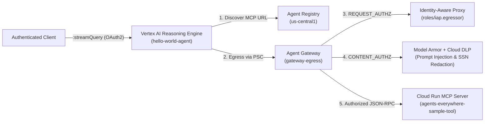

# Governed Enterprise Agent with Agent Gateway, IAP, Model Armor & DLP

This repository contains the **Hello World Enterprise Agent** (`hello-world-agent`) deployed on **Vertex AI Reasoning Engine (Agent Runtime)** and governed end-to-end by **Google Cloud Agent Gateway**, **Agent Registry**, **Identity-Aware Proxy (IAP)**, **Model Armor**, and **Cloud Data Loss Prevention (Sensitive Data Protection)**.

For the complete step-by-step deployment, policy enforcement, troubleshooting, and verification guide, see **[RUNBOOK.md](./RUNBOOK.md)**.

---

## Architecture Overview



---

## Repository Structure

```text
.
├── Dockerfile                  # Container image definition for Agent Runtime
├── README.md                   # Architecture & project documentation
├── RUNBOOK.md                  # End-to-end step-by-step runbook (Tasks 1–7)
├── agents-cli-manifest.yaml    # Manifest for google-agents-cli deployment
├── deployment_metadata.json    # Reasoning Engine deployment metadata
├── pyproject.toml              # Python package & dependency configuration
├── requirements.txt            # Runtime dependencies
├── app/
│   ├── agent.py                # RootAgent ADK implementation, OIDC auth & MCP client
│   ├── agent_runtime_app.py    # Entrypoint for agents-cli runtime
│   ├── main.py                 # FastAPI / ASGI wrapper for Reasoning Engine
│   └── models.py               # Pydantic schemas for Agent input/output & MCP JSON-RPC
└── tests/                      # Unit tests for agent, models, and FastAPI routes
```

---

## Key Capabilities & Security Controls

1. **Dynamic Tool Discovery (`Agent Registry`)**:
   - [`resolve_tool_uri()`](./app/agent.py) resolves the target MCP server URL dynamically from `agentregistry.googleapis.com` using native workload identity credentials.
2. **Zero-Trust Egress (`Agent Gateway` + `IAP`)**:
   - Outbound tool calls from Vertex AI Reasoning Engine route through the `gateway-egress` Agent Gateway (`AGENT_TO_ANYWHERE` governed access path).
   - `google_network_services_authz_extension.iap_authz_extension` and `google_network_security_authz_policy.egress_authz_policy` enforce active `REQUEST_AUTHZ` verification against the Agent Registry MCP server's `roles/iap.egressor` bindings.
3. **Inline AI Safety & PII Redaction (`Model Armor` + `Sensitive Data Protection`)**:
   - `google_network_services_authz_extension.model_armor` and `google_network_security_authz_policy.model_armor` attach `CONTENT_AUTHZ` streaming inspection to the Agent Gateway.
   - **Prompt Injection / Jailbreak Defense**: Blocks adversarial instructions at the network edge with HTTP `403` (`custom_prompt_safety_error_code = 799`).
   - **Sensitive Data Protection (DLP)**: Automatically inspects and de-identifies `US_SOCIAL_SECURITY_NUMBER` tokens into `[US_SOCIAL_SECURITY_NUMBER]` before payloads reach the MCP tool.
