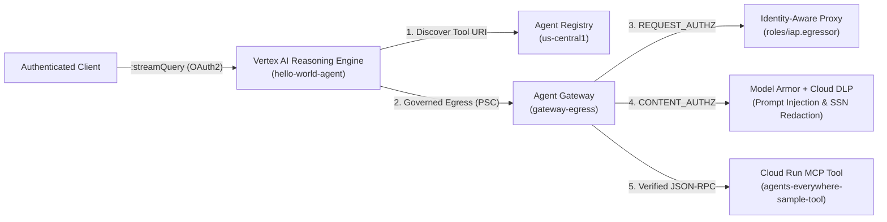

# [FDE]: Secure AI Agents: Zero-Trust Perimeters and Inline Governance (`L400-APEX-004`)

This repository contains the complete implementation, infrastructure-as-code (Terraform), Model Context Protocol (MCP) tool microservice, Vertex AI Reasoning Engine (ADK Agent), and step-by-step operational runbook for **[FDE]: Secure AI Agents: Zero-Trust Perimeters and Inline Governance (`L400-APEX-004`)**.

👉 **For the complete step-by-step lab guide & operational handbook (Tasks 1–8), see [RUNBOOK.md](./RUNBOOK.md).**

---

## Challenge & Scenario Overview

Generative AI agents are evolving into autonomous systems that execute tools and access enterprise data. Traditional network security models struggle to govern dynamic agent-to-tool communications, and unmanaged tool execution introduces critical risks including **prompt injection**, **unauthorized data access**, and **sensitive data leakage**.

In this project, as Lead Cloud Security Engineer at **Cymbal Group**, we secure the organization's Generative AI platform where an ADK agent (`hello-world-agent`) connects to a serverless MCP tool service (`agents-everywhere-sample-tool`):

1. **Private, Governed Network Perimeter**: Custom VPC (`governed-agent-vpc`), private subnet (`agent-private-subnet`), Private Service Connect (PSC) network attachment (`gateway-egress-na`), and a regional **Agent Gateway** (`gateway-egress`).
2. **Centralized Service Discovery**: Both the Cloud Run MCP tool microservice and the Vertex AI Reasoning Engine ADK agent are registered in the regional **Agent Registry** (`us-central1`).
3. **Zero-Trust Egress Access Control**: Outbound tool invocations are gated by **Identity-Aware Proxy (IAP)** (`REQUEST_AUTHZ`), verifying native Workload Identity SPIFFE credentials (`roles/iap.egressor`) before forwarding requests.
4. **Inline AI Content Safety & Privacy Guardrails**: **Model Armor** and **Cloud Data Loss Prevention (Sensitive Data Protection)** are attached inline at the Agent Gateway edge (`CONTENT_AUTHZ`) to block adversarial prompt injections (`HTTP 403`) and automatically redact plaintext Social Security Numbers (`[US_SOCIAL_SECURITY_NUMBER]`).

---

## End-to-End Architecture



---

## Repository Structure

```text
.
├── README.md                                          # Project overview & architecture
├── RUNBOOK.md                                         # Complete step-by-step handbook (Tasks 1–8)
├── Dockerfile                                         # Container image for hello-world-agent
├── agents-cli-manifest.yaml                           # Manifest for google-agents-cli deployment
├── deployment_metadata.json                           # Reasoning Engine deployment metadata
├── pyproject.toml                                     # Agent Python package configuration
├── requirements.txt                                   # Agent Python dependencies
├── toolspec.json                                      # MCP Server TOOL_SPEC capability schemas
├── app/                                               # ADK Agent Runtime source code
│   ├── agent.py                                       # RootAgent logic, Agent Registry discovery & OIDC auth
│   ├── agent_runtime_app.py                           # Agent Runtime entrypoint
│   ├── main.py                                        # FastAPI / ASGI streaming wrapper
│   └── models.py                                      # Pydantic models for Agent & MCP JSON-RPC 2.0
├── mcp-servers/
│   └── sample-tool/                                   # Cloud Run MCP Server (FastMCP)
│       ├── Dockerfile
│       ├── models.py
│       ├── server.py                                  # HTTP JSON-RPC handler (/ and /mcp)
│       └── tests/
├── scripts/
│   └── lab-cleanup.sh                                 # Task 8 resource cleanup script
├── terraform/                                         # Infrastructure-as-Code modules
│   ├── main.tf                                        # Root orchestrator
│   ├── networking/                                    # VPC, private subnet, PSC attachment
│   ├── registry/                                      # Agent Registry API, IAP bindings & endpoint registration
│   ├── gateway/                                       # Agent Gateway, IAP & Model Armor Authz policies
│   └── model-armor/                                   # DLP Inspect/De-identify templates & Model Armor templates
└── tests/                                             # Unit test suite for hello-world-agent
```

---

## Summary of Lab Tasks

| Task | Objective | Key Components |
| :--- | :--- | :--- |
| **[Task 1](./RUNBOOK.md#task-1-prepare-the-environment-and-download-the-lab-files)** | Prepare the environment and download lab files | `gcloud`, `google-agents-cli`, `terraform` |
| **[Task 2](./RUNBOOK.md#task-2-explore-the-terraform-configuration-and-deploy-the-base-infrastructure)** | Explore Terraform & deploy base infrastructure (`DRY_RUN`) | VPC, PSC Network Attachment, Agent Registry, Agent Gateway |
| **[Task 3](./RUNBOOK.md#task-3-deploy-the-application-runtimes)** | Deploy Cloud Run MCP tool & Vertex AI Reasoning Engine agent | Cloud Run, Agent Registry (`TOOL_SPEC` & `NO_SPEC`), Reasoning Engine |
| **[Task 4](./RUNBOOK.md#task-4-enforce-the-access-control-policies)** | Enforce Zero-Trust access control policies with IAP | Cloud Run IAM, Workload Identity, `roles/iap.egressor`, `enable_iap_enforcement=true` |
| **[Task 5](./RUNBOOK.md#task-5-verify-secure-ingress-invocation-with-a-basic-query)** | Verify secure ingress & governed egress invocation | Reasoning Engine `:streamQuery` (`get_capital` -> `"Paris"`) |
| **[Task 6](./RUNBOOK.md#task-6-enforce-the-content-safety-policies-with-model-armor-and-sensitive-data-protection)** | Enforce inline content safety with Model Armor & DLP | `enable_model_armor=true`, DLP SSN templates, `CONTENT_AUTHZ` |
| **[Task 7](./RUNBOOK.md#task-7-test-the-content-safety-and-sensitive-data-protection-triggers)** | Test prompt injection defense & DLP SSN redaction | HTTP 403 intervention & `[US_SOCIAL_SECURITY_NUMBER]` redaction |
| **[Task 8](./RUNBOOK.md#task-8-clean-up-lab-resources-required)** | Clean up lab resources | `scripts/lab-cleanup.sh` |
